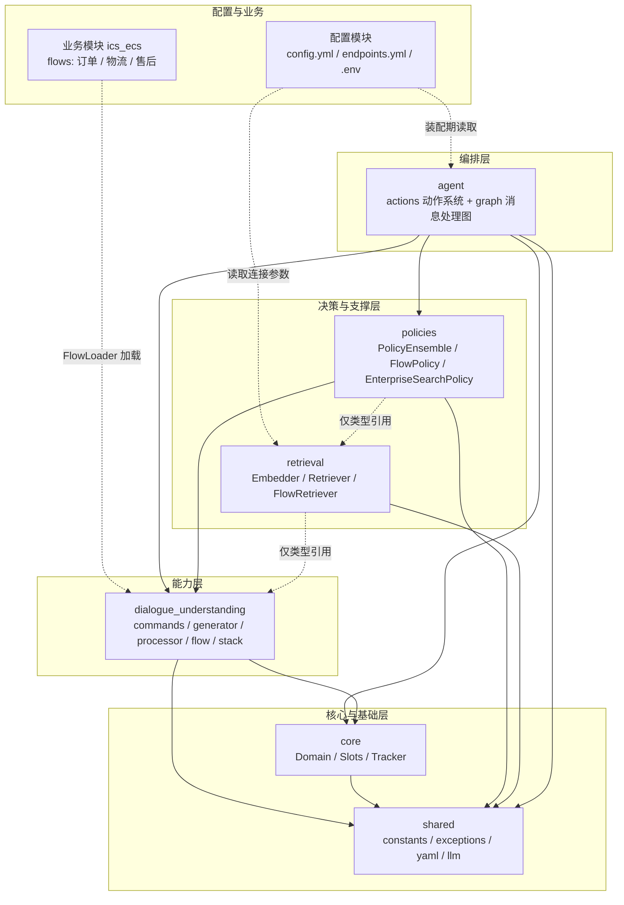
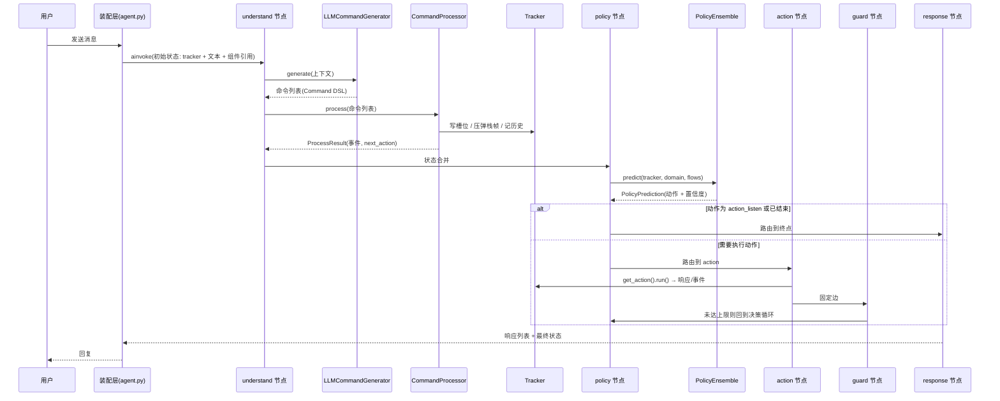

# 智能客服系统（ICS）项目介绍

> 一句话概括：这是一个**以 LLM 为理解引擎、以 Flow 为业务骨架、以 LangGraph 为运行时编排**的电商智能客服系统，整体思路对标 Rasa CALM（Command / Flow / Policy 三层架构）。

---

## 1. 项目定位与技术栈

| 维度 | 内容 |
| --- | --- |
| 业务场景 | 电商客服：订单查询/取消、物流查询、售后申请、知识问答、闲聊与人工转接 |
| 核心思路 | 用户消息 → LLM 翻译成结构化「命令」→ 命令更新对话状态 → 策略决定下一步「动作」→ Flow 推进业务流程 |
| 语言/包管理 | Python 3.12、uv（src 布局，包名 `app`） |
| 编排 | LangGraph（StateGraph + 条件边） |
| LLM | LangChain 适配 OpenAI / 通义千问（DashScope）/ Azure / Anthropic，默认 `qwen-plus` |
| 检索 | 抽象检索接口 + 可插拔 Embedder（云端 OpenAI 兼容 / 本地 sentence-transformers），配置指向 Neo4j |
| 业务数据 | MySQL（订单/物流/售后），对话状态默认内存 TrackerStore |

---

## 2. 模块总览：一共 8 个模块

项目按「配置 → 框架 → 业务」三层组织，共 **8 个模块**（6 个框架核心模块 + 2 个外围模块）。

| # | 模块 | 代码位置 | 一句话职责 | 层次 |
| --- | --- | --- | --- | --- |
| 1 | **配置模块** | [configurations/](configurations) | 声明式定义流水线、策略与全部外部端点 | 外围/配置层 |
| 2 | **shared 共享基础** | [src/app/ics_ai/shared/](src/app/ics_ai/shared) | 常量、异常、YAML 工具、统一 LLM 客户端 | 框架·最底层 |
| 3 | **core 对话状态核心** | [src/app/ics_ai/core/](src/app/ics_ai/core) | 领域配置（Domain）、槽位体系、对话状态追踪（Tracker） | 框架·核心层 |
| 4 | **dialogue_understanding 对话理解** | [src/app/ics_ai/dialogue_understanding/](src/app/ics_ai/dialogue_understanding) | 命令生成/解析/执行、Flow 定义与执行、对话栈 | 框架·能力层 |
| 5 | **policies 策略决策** | [src/app/ics_ai/policies/](src/app/ics_ai/policies) | 决定下一步做什么：流程推进 / 知识检索兜底 / 多策略裁决 | 框架·决策层 |
| 6 | **retrieval 知识检索** | [src/app/ics_ai/retrieval/](src/app/ics_ai/retrieval) | 向量化、向量库抽象、Flow 语义检索 | 框架·支撑层 |
| 7 | **agent 运行时编排** | [src/app/ics_ai/agent/](src/app/ics_ai/agent) | 动作（Action）系统 + LangGraph 消息处理图 | 框架·编排层 |
| 8 | **ics_ecs 业务模块** | [src/app/ics_ecs/](src/app/ics_ecs) | 电商业务知识：订单/物流/售后三个 Flow 定义 | 外围/业务层 |

此外还有入口文件 [src/app/__init__.py](src/app/__init__.py)（当前为占位 `main()`）与空的 `tests/`，见第 7 节「当前实现状态」。

---

## 3. 整体架构图

---

## 4. 各模块职责、作用与设计原因

### 4.1 配置模块（configurations）

**职责与作用**
- [config.yml](configurations/config.yml)：声明流水线 `LLMCommandGenerator` 与策略链 `FlowPolicy` → `EnterpriseSearchPolicy`，即"消息如何被理解、如何被决策"。
- [endpoints.yml](configurations/endpoints.yml)：声明 LLM（qwen-plus）、向量库（Neo4j bolt）、业务库（MySQL）、TrackerStore（内存）、NLG 开关等外部端点。
- `.env`：只放密钥（DashScope / Neo4j / MySQL / 硅基流动），通过 `${VAR}` 注入。

**为什么这样设计**
1. **行为与代码解耦**：启用哪些组件、哪家模型、哪个向量库都由配置决定，换实现不改代码，便于灰度与回退。
2. **密钥与代码分离**：凭据走环境变量，仓库内不落明文。
3. **与 Rasa 生态对齐**：`recipe / language / pipeline / policies` 的结构可直接与 Rasa 文档互参，降低学习成本。

---

### 4.2 shared 共享基础模块

**职责与作用**
- `constants.py`：默认路径/端口、系统动作名（`action_listen` 等）、槽位类型、降级原因等全系统唯一取值来源。
- `exceptions.py`：`ICSException` 异常层次（配置、LLM、槽位值、Tracker 等）。
- `yaml_loader.py`：YAML 读取与合并，供 Domain / FlowLoader 复用。
- `llm/`：`LLMClient` 抽象 + `LLMResponse` DTO + `LangChainClient`（openai/qwen/azure/anthropic 四后端）+ `create_llm_client` 工厂。

**为什么这样设计**
1. **消灭魔法值**：所有模块引用同一常量，避免"各写各的动作名"导致行为漂移。
2. **异常可分级处理**：上层按异常类型决定重试、降级还是报错。
3. **LLM 只有一个适配点**：厂商差异被 `LangChainClient` 收口，业务层只依赖 `LLMClient` 契约；改模型只动一处。
4. **依赖方向最低**：它是全项目唯一"谁都可以依赖、它不依赖任何内部模块"的层，是避免循环依赖的地基。

---

### 4.3 core 对话状态核心模块

**职责与作用**
- `domain.py`：`Domain` 是配置聚合根，加载 YAML 后提供槽位、动作、响应模板、Flow 等查询能力；`ResponseTemplate` 支持文本/按钮/图片/条件变体。
- `slots.py`：`Slot` 抽象 + 6 种具体槽位（text/bool/float/list/categorical/any）+ 映射类型（`from_llm` / `controlled`）+ `create_slot` 工厂。
- `tracker.py`：`UserMessage` / `BotMessage` / `DialogueTurn` / `DialogueStateTracker`，记录槽位值、消息历史、对话栈与 Flow 执行历史，并支持 `to_dict/from_dict` 序列化。

**为什么这样设计**
1. **"配置 / 数据 / 运行时状态"三分**：Domain 只读、Slot 只描述数据、Tracker 承载单次会话状态，职责边界清晰，便于持久化与恢复。
2. **槽位带类型与来源**：`from_llm` 与 `controlled` 区分"LLM 抽取"和"业务代码写入"，防止 LLM 越权改写关键字段。
3. **唯一状态源**：策略、动作、提示词构建都读同一个 Tracker，避免多层各存一份状态导致不一致。

---

### 4.4 dialogue_understanding 对话理解模块

这是系统的"理解与流程"引擎，内部再分 5 个子模块：

| 子模块 | 职责 |
| --- | --- |
| `commands/` | `Command` 抽象 + 17 个具体命令（回答/错误/流程/会话/槽位五族）+ 注册表 + DSL 序列化 |
| `generator/` | `LLMCommandGenerator`：Jinja2 提示词构建 → LLM 调用 → DSL 解析 → 错误映射，输出 `GenerationResult` |
| `processor/` | `CommandProcessor`：逐条执行命令，写入槽位/栈帧，产出 `ProcessResult`（事件、计数、响应类型、`next_action`） |
| `flow/` | `Flow` / `FlowStep` / `FlowsList` 数据结构、`FlowLoader`（YAML 加载）、`FlowExecutor`（7 种步骤：action/collect/link/set_slot/condition/end/call） |
| `stack/` | `DialogueStack`（LIFO）+ 多种栈帧（Flow / Search / ChitChat / CannotHandle / Completed / HumanHandoff） |

**为什么这样设计**
1. **命令模式收口 LLM 输出**：LLM 只能输出受限命令 DSL，不能直接改状态；命令可校验、可回放、可审计，这是"可控"的关键。
2. **生成与执行分离**：`generator` 只负责"翻译"，`processor` 只负责"落地"。换模型、换提示词不影响执行；加缓存或做评测也只动生成侧。
3. **Flow 把业务流程配置化**：业务流程写在 YAML（业务模块），执行引擎通用，新增业务域不需要改框架代码。
4. **对话栈支撑"嵌套与打断"**：用户在一段流程中临时问别的问题，可压入新栈帧处理完再弹回；这是 CALM 相比传统"意图+槽位"状态机的核心优势。

---

### 4.5 policies 策略决策模块

**职责与作用**
- `base_policy.py`：`Policy` 抽象、`PolicyConfig`、`PolicyPrediction`（动作 + 置信度 + 事件 + 元数据）。
- `flow_policy.py`：优先级 **100**，有活动 Flow 栈帧时驱动 `FlowExecutor` 逐步推进；用 `max_steps_per_turn` 限制单轮步数，异常时降级到兜底动作。
- `enterprise_search_policy.py`：优先级 **50**，按栈顶帧类型分发（Search / ChitChat / CannotHandle / Completed / HumanHandoff），RAG 检索 + 生成，检索失败或无命中时逐级降级（闲聊 → 默认兜底）。
- `policy_ensemble.py`：按优先级遍历策略、过滤放弃项、取最高置信度（1.0 提前短路），全部放弃时回退 `action_listen`。

**为什么这样设计**
1. **确定性优先、生成式兜底**：业务流程必须稳定可复现，所以 FlowPolicy 优先级最高；知识问答不确定性高，放在其后。
2. **策略模式 + 集成器**：新增能力 = 新增一个策略类，不改现有逻辑；裁决规则集中在集成器，便于统一调优先级。
3. **窄接口**：策略只接收 `tracker / domain / flows` 并返回 `PolicyPrediction`，不感知图结构、网络与存储，易测试。

---

### 4.6 retrieval 知识检索模块

**职责与作用**
- `base_retriever.py`：`InformationRetrieval`（`connect` + `search` 最小契约）、`SearchResult` / `Document`。
- `embedder.py`：`Embedder` 抽象 + `OpenAIEmbedder`（OpenAI 兼容，默认 bge-m3）+ `LocalEmbedder`（sentence-transformers）+ `create_embedder`；统一做 L2 归一化。
- `flow_retriever.py`：把 Flow 的"名称 + 描述 + 触发条件"向量化建内存索引，按余弦相似度返回候选流程。
- `create_retriever`：按配置中的类路径动态加载检索器并 `connect`。

**为什么这样设计**
1. **业务不绑定具体向量库**：配置里写类路径即可替换 Neo4j / Qdrant / 自研实现，降低基础设施耦合。
2. **Embedding 可云可本地**：云端追求效果、本地追求离线与成本，通过工厂切换。
3. **FlowRetriever 补足 LLM 匹配**：语义检索为"用户说法 → 业务流程"提供候选，减少纯提示词匹配的漏召回。

---

### 4.7 agent 运行时编排模块

**职责与作用**
- `actions.py`：`Action` 抽象 + `ActionResult`；15 个内置动作（监听、重启、会话开始、兜底、闲聊、取消/切换流程、清栈、槽位抽取、发文本、帮助、澄清、人工转接、流程完成、触发检索）+ `utter_` 前缀动态构造；`get_action` 按名解析（自定义 > 内置 > `utter_`）。
- `graph/`：LangGraph 消息处理图
  - `state.py`：`MessageProcessingState` 与 `create_initial_state`（每轮消息的状态通道）；
  - `builder.py`：装配并编译图，提供单例获取与重置；
  - `edges.py`：`should_execute_action`（policy 后）、`should_continue`（guard 后）；
  - `nodes/`：`understand → policy → action → guard → response` 五个节点。

**为什么这样设计**
1. **显式状态机**：一轮对话被固化为五个可观测节点，每步输入输出都是状态字典，便于日志、断点与单测。
2. **双重熔断**：`guard` 限制单轮动作数，条件边在 `action_listen` 时直接收尾，避免"策略↔动作"无限循环。
3. **依赖注入而非全局单例**：生成器/处理器/策略集成器经状态通道（`_command_*` 字段）传入，图本身无业务状态，可复用、可并行。
4. **Action 可插拔**：业务自定义动作注册即可覆盖内置实现，`utter_` 约定免去为每条话术写类。

---

### 4.8 ics_ecs 业务模块

**职责与作用**
- [data/flows/](src/app/ics_ecs/data/flows)：三个业务域流程
  - `flow_order.yml`：切换账号、查询订单详情、修改收货信息、取消订单
  - `flow_logistics.yml`：查询支持快递公司、查询物流信息
  - `flow_postsale.yml`：申请退货/换货
- 每个 Flow 由 `description` 供 LLM 匹配、`steps` 描述业务步骤、`next/if-then-else` 控制分支。

**为什么这样设计**
1. **框架与业务彻底分离**：业务知识用 YAML 表达，框架只提供解释执行能力。
2. **业务迭代零代码**：新增流程、改话术、调分支只改 YAML，可评审、可版本化。
3. **与自定义 Action 配合**：需要查库/写库的步骤调用业务 Action（规划中），Flow 只负责编排。

---

## 5. 模块之间的调用与依赖关系

### 5.1 依赖方向（谁依赖谁）

| 模块 | 依赖的内部模块 | 说明 |
| --- | --- | --- |
| shared | 无 | 最底层，仅标准库 + 第三方 |
| core | shared；`tracker → stack` | `domain/slots` 依赖常量与 YAML 工具；`tracker` 直接持有 `DialogueStack` |
| dialogue_understanding | shared、core | `commands` 依赖常量；`flow` 依赖 `yaml_loader` 与 `stack`；`generator` 依赖 `llm` |
| policies | shared、core（仅类型）、dialogue_understanding | `flow_policy → FlowExecutor + FlowStackFrame`；`enterprise_search → LLM`；`retrieval` 仅类型引用 |
| retrieval | shared（间接）；flow 仅类型引用 | 独立可替换，运行时不需要 Flow 实体 |
| agent | shared、core、dialogue_understanding、policies | 唯一"组装层"，动作与图节点把下层能力串起来 |
| 配置模块 | 无代码依赖 | 被装配期读取，不被 import |
| ics_ecs | 无代码依赖 | 只被 `FlowLoader` 当数据读取 |

**分层规则**：只允许"上层依赖下层"，同层不互相依赖；`agent` 是唯一允许同时依赖决策层与能力层的模块。

### 5.2 一条用户消息的完整调用链

图结构固定为：`START → understand → policy → [条件边] → action → guard → [条件边] → policy / response → END`。

### 5.3 依赖解环的三个手段

1. **`TYPE_CHECKING` 延迟引用**：`tracker` 持有 `DialogueStack`，而 `flow_executor/flow_policy` 又需要 `DialogueStateTracker` 类型；后者把 Tracker/Domain 放进 `TYPE_CHECKING` 分支，运行时不解引用，避免 `core ↔ dialogue_understanding` 循环导入。
2. **注册表解耦**：命令通过 `@register_command` 注册、动作通过 `_BUILTIN_ACTIONS/_CUSTOM_ACTIONS` 注册，调用方只按名字字符串取实例，不 import 具体类。
3. **状态通道注入**：图节点不构造生成器/处理器/策略，由装配层放进状态字典，`graph` 对具体实现零依赖。

---

## 6. 为什么这样分层：五个核心取舍

| 取舍 | 具体做法 | 收益 |
| --- | --- | --- |
| **LLM 只做翻译，不做状态操作** | LLM 输出命令 DSL，由 `CommandProcessor` 执行 | 可控、可审计、可回放，避免模型直接改业务数据 |
| **流程确定性优先** | FlowPolicy 优先级 100 > 检索策略 50 | 关键业务（取消订单等）行为稳定 |
| **能力可替换** | LLM/Embedder/Retriever/策略/动作均为抽象 + 工厂/注册表 | 换模型、换向量库、加策略无需改调用方 |
| **业务配置化** | Flow 用 YAML 描述，框架解释执行 | 业务同学可独立改流程，回归范围小 |
| **运行时显式化** | LangGraph 五节点 + 条件边 + guard 熔断 | 每轮对话可追踪、可测试、不会死循环 |

---

## 7. 当前实现状态（阅读前须知）

| 状态 | 内容 |
| --- | --- |
| ✅ 已实现 | `shared`、`core`、`dialogue_understanding`（commands/generator/processor/flow/stack）、`policies`、`retrieval`、`agent`（actions + graph）、三个业务 Flow YAML |
| 🚧 占位 | [src/app/__init__.py](src/app/__init__.py) 的 `main()` 仅打印一句话；`dialogue_understanding/nlg/` 为空包 |
| ❌ 尚未实现 | 装配层（`agent.py` / `message_processor` 仅在注释中被引用）、HTTP/SocketIO 服务端、`ics_ecs` 的 `domain.yml` 与自定义 `actions/`、`tests/` 测试用例 |
| ⚠️ 配置待对齐 | [config.yml](configurations/config.yml#L24) 中 `vector_store: addons.information_retrieval.GraphRAG` 指向的类在当前仓库不存在；可用的检索器实现位于 `app.ics_ai.retrieval` |

结论：**框架骨架已完整、可单测，但从"用户消息进入"到"服务对外提供"的装配与服务层尚未接通**。

---

## 8. 建议阅读顺序

1. [config.yml](configurations/config.yml) / [endpoints.yml](configurations/endpoints.yml)：先看系统被声明成什么样。
2. [core/tracker.py](src/app/ics_ai/core/tracker.py)：理解"状态"这个中心概念。
3. [agent/graph/builder.py](src/app/ics_ai/agent/graph/builder.py)：看清一轮消息的固定拓扑。
4. [dialogue_understanding/commands/base.py](src/app/ics_ai/dialogue_understanding/commands/base.py) + `flow/flow_executor.py`：理解命令与流程如何驱动对话。
5. [policies/policy_ensemble.py](src/app/ics_ai/policies/policy_ensemble.py)：理解"下一步做什么"如何被裁决。
6. [ics_ecs/data/flows/flow_order.yml](src/app/ics_ecs/data/flows/flow_order.yml)：看业务如何用 YAML 表达。
