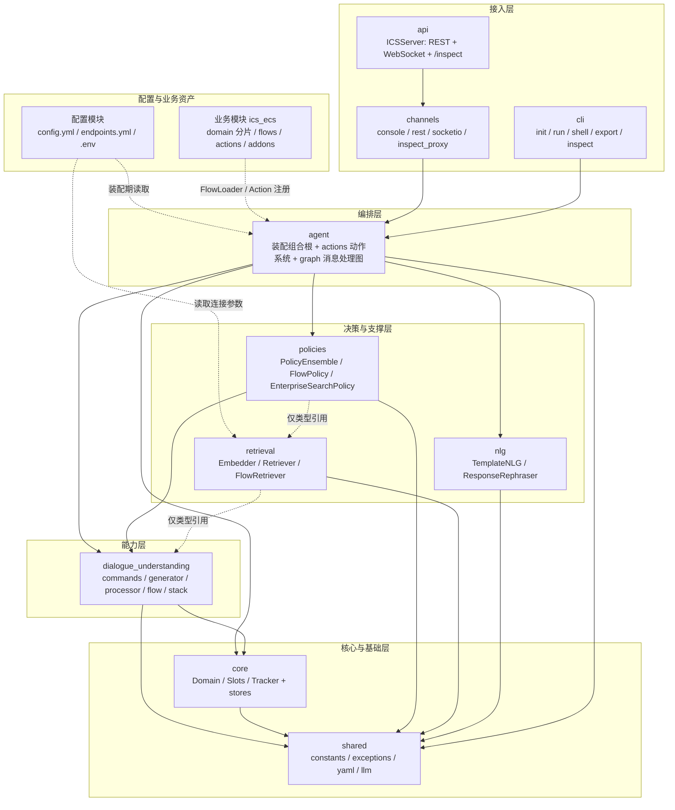
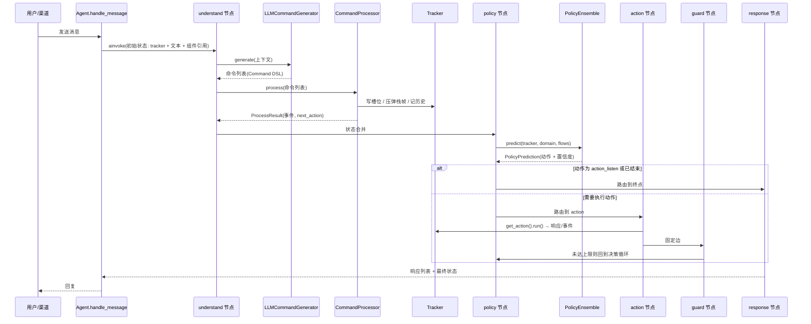

# 智能客服系统（ICS）

> 一句话概括：这是一个**以 LLM 为理解引擎、以 Flow 为业务骨架、以 LangGraph 为运行时编排**的电商智能客服系统。整体思路对标 Rasa CALM（Command / Flow / Policy 三层架构），并已打通「装配 → 渠道 → 服务」全链路，可直接启动对话。

---

## 1. 快速开始

**环境要求**：Python 3.12、[uv](https://docs.astral.sh/uv/)、MySQL（库名 `ecs`）；Neo4j 与本地 Embedding 模型为可选项。

```bash
# 1) 安装依赖
uv sync

# 2) 配置密钥：在仓库根创建 .env
#    DASHSCOPE_API_KEY=...        # LLM（默认通义千问 qwen-plus）
#    MYSQL_PASSWORD=...           # 业务库 MySQL
#    NEO4J_PASSWORD=...           # 可选，知识检索

# 3) 灌入业务数据（先清空 8 张业务表，再写入 30 条收货信息 + 200 笔订单及其明细/物流/售后）
uv run python -m app.ics_ecs.gen_data

# 4) 启动
uv run python -m app.ics_ecs                      # 控制台交互模式（默认）
uv run python -m app.ics_ecs --serve --inspect    # 服务模式 + 调试页
```

服务模式下打开 **http://127.0.0.1:5005/inspect** 即为三栏调试面板：左栏 Flow History / Slots / Events / Tracker，中栏 Flow 流程图，右栏聊天窗口（内置 `用户ID` 切换，演示账号 `1001`）。

框架层 CLI 也可直接用（需自行保证配置路径与项目目录同树）：

```bash
uv run python -m app.ics_ai --help     # init / run / shell / export / inspect 五个子命令
```

### 服务端接口

| 方法 | 路径 | 说明 |
| --- | --- | --- |
| GET | `/`、`/health` | 健康检查（含 `agent_ready`） |
| POST | `/api/messages` | 发送用户消息，返回回复列表 |
| GET | `/api/sessions/{session_id}` | 会话信息 |
| POST | `/api/sessions/{session_id}/reset` | 重置会话 |
| GET | `/api/domain` | 当前 Domain（槽位/响应/动作） |
| GET | `/api/flows` | 全部 Flow 定义 |
| GET | `/api/tracker/{session_id}/full` | 完整 Tracker 快照（调试面板数据源） |
| WS | `/api/stream` | 实时消息与状态推送 |
| GET | `/inspect` | 调试页（需 `--inspect` 开启） |

---

## 2. 项目定位与技术栈

| 维度 | 内容 |
| --- | --- |
| 业务场景 | 电商客服：订单查询/取消、修改收货信息、物流查询、售后申请、知识问答、闲聊与人工转接 |
| 核心思路 | 用户消息 → LLM 翻译成结构化「命令」→ 命令更新对话状态 → 策略决定下一步「动作」→ Flow 推进业务流程 |
| 语言/包管理 | Python 3.12、uv（src 布局，包名 `app`） |
| 编排 | LangGraph（StateGraph + 条件边） |
| LLM | LangChain 适配 OpenAI / 通义千问（DashScope）/ Azure / Anthropic，默认 `qwen-plus` |
| 检索 | 抽象检索接口 + 可插拔 Embedder（云端 OpenAI 兼容 / 本地 sentence-transformers），业务侧实现指向 Neo4j |
| NLG | 模板生成（`TemplateNLG`）+ 可选 LLM 重述（`ResponseRephraser`） |
| 业务数据 | MySQL（订单/物流/售后），对话状态支持内存 / JSON 文件 / MySQL 三种 TrackerStore |
| 对外形态 | 控制台 / REST / WebSocket / 调试页 四种渠道 |

---

## 3. 模块总览

项目按「配置 → 框架 → 业务」三层组织，共 **14 个模块**（配置 1 + 框架 10 + 业务 1，业务内部再分 5 个资产目录）。

| # | 模块 | 代码位置 | 一句话职责 | 层次 |
| --- | --- | --- | --- | --- |
| 1 | **配置模块** | [configurations/](configurations) | 声明式定义流水线、策略、检索与全部外部端点 | 配置层 |
| 2 | **shared 共享基础** | [src/app/ics_ai/shared/](src/app/ics_ai/shared) | 常量、异常、YAML 工具、统一 LLM 客户端 | 框架·最底层 |
| 3 | **core 对话状态核心** | [src/app/ics_ai/core/](src/app/ics_ai/core) | 领域配置（Domain）、槽位体系、对话状态追踪（Tracker）与持久化（stores） | 框架·核心层 |
| 4 | **dialogue_understanding 对话理解** | [src/app/ics_ai/dialogue_understanding/](src/app/ics_ai/dialogue_understanding) | 命令生成/解析/执行、Flow 定义与执行、对话栈 | 框架·能力层 |
| 5 | **nlg 自然语言生成** | [src/app/ics_ai/nlg/](src/app/ics_ai/nlg) | 模板回复生成与可选 LLM 重述 | 框架·能力层 |
| 6 | **retrieval 知识检索** | [src/app/ics_ai/retrieval/](src/app/ics_ai/retrieval) | 向量化、向量库抽象、Flow 语义检索 | 框架·支撑层 |
| 7 | **policies 策略决策** | [src/app/ics_ai/policies/](src/app/ics_ai/policies) | 决定下一步做什么：流程推进 / 知识检索兜底 / 多策略裁决 | 框架·决策层 |
| 8 | **agent 运行时编排** | [src/app/ics_ai/agent/](src/app/ics_ai/agent) | 装配组合根 + 动作（Action）系统 + LangGraph 消息处理图 | 框架·编排层 |
| 9 | **channels 渠道接入** | [src/app/ics_ai/channels/](src/app/ics_ai/channels) | 控制台 / REST / Socket.IO / 调试页代理四种输入输出通道 | 框架·接入层 |
| 10 | **api 服务端** | [src/app/ics_ai/api/](src/app/ics_ai/api) | FastAPI 应用：REST、WebSocket、调试页模板 | 框架·接入层 |
| 11 | **cli 命令行** | [src/app/ics_ai/cli/](src/app/ics_ai/cli) | `init / run / shell / export / inspect` 五个子命令 | 框架·接入层 |
| 12 | **ics_ecs 业务模块** | [src/app/ics_ecs/](src/app/ics_ecs) | 电商业务资产：Domain 分片、Flow、业务 Action、检索器、造数脚本 | 业务层 |
| 13 | **包入口** | [src/app/\_\_init\_\_.py](src/app/__init__.py) | `app` 包 `main()`（当前为占位实现） | — |
| 14 | **业务启动入口** | [src/app/ics_ecs/\_\_main\_\_.py](src/app/ics_ecs/__main__.py) | 装配 ics_ecs 并选择控制台/服务模式 | 业务层 |

---

## 4. 整体架构图



---

## 5. 各模块职责、作用与设计原因

### 5.1 配置模块（configurations）

**职责与作用**
- [config.yml](configurations/config.yml)：声明流水线 `LLMCommandGenerator` 与策略链 `FlowPolicy` → `EnterpriseSearchPolicy`，即"消息如何被理解、如何被决策"。
- [endpoints.yml](configurations/endpoints.yml)：声明 LLM（qwen-plus）、向量库（Neo4j bolt）、业务库（MySQL）、TrackerStore、NLG 开关等外部端点。
- `.env`：只放密钥（DashScope / Neo4j / MySQL / 硅基流动），通过 `${VAR}` 注入。

**为什么这样设计**
1. **行为与代码解耦**：启用哪些组件、哪家模型、哪个向量库都由配置决定，换实现不改代码，便于灰度与回退。
2. **密钥与代码分离**：凭据走环境变量，仓库内不落明文。
3. **与 Rasa 生态对齐**：`recipe / language / pipeline / policies` 的结构可直接与 Rasa 文档互参，降低学习成本。

---

### 5.2 shared 共享基础模块

**职责与作用**
- `constants.py`：默认路径/端口、系统动作名（`action_listen` 等）、槽位类型、降级原因等全系统唯一取值来源。
- `exceptions.py`：`ICSException` 异常层次（配置、LLM、槽位值、Tracker 等）。
- `yaml_loader.py`：YAML 读取与合并，供 Domain / FlowLoader 复用。
- `llm/`：`LLMClient` 抽象 + `LLMResponse` DTO + `LangChainClient`（openai/qwen/azure/anthropic 四后端）+ `create_llm_client` 工厂。

**为什么这样设计**
1. **消灭魔法值**：所有模块引用同一常量，避免"各写各的动作名"导致行为漂移。
2. **异常可分级处理**：上层按异常类型决定重试、降级还是报错。
3. **LLM 只有一个适配点**：厂商差异被 `LangChainClient` 收口，业务层只依赖 `LLMClient` 契约；改模型只动一处。
4. **依赖方向最低**：它是全项目唯一"谁都可以依赖、它不依赖任何内部模块"的层，是避免循环依赖的地基。

---

### 5.3 core 对话状态核心模块

**职责与作用**
- `domain.py`：`Domain` 是配置聚合根，加载 YAML 后提供槽位、动作、响应模板、Flow 等查询能力；`ResponseTemplate` 支持文本/按钮/图片/条件变体；支持目录模式自动合并多个分片 YAML。
- `slots.py`：`Slot` 抽象 + 6 种具体槽位（text/bool/float/list/categorical/any）+ 映射类型（`from_llm` / `controlled`）+ `create_slot` 工厂。
- `tracker.py`：`UserMessage` / `BotMessage` / `DialogueTurn` / `DialogueStateTracker`，记录槽位值、消息历史、对话栈与 Flow 执行历史，并支持 `to_dict/from_dict` 序列化。
- `stores/`：`TrackerStore` 抽象 + `JsonTrackerStore`（文件持久化）+ `MySQLTrackerStore`（落库），默认内存实现。

**为什么这样设计**
1. **"配置 / 数据 / 运行时状态"三分**：Domain 只读、Slot 只描述数据、Tracker 承载单次会话状态，职责边界清晰，便于持久化与恢复。
2. **槽位带类型与来源**：`from_llm` 与 `controlled` 区分"LLM 抽取"和"业务代码写入"，防止 LLM 越权改写关键字段。
3. **唯一状态源**：策略、动作、提示词构建都读同一个 Tracker，避免多层各存一份状态导致不一致。
4. **状态可换存储**：Tracker 只依赖 `TrackerStore` 契约，内存/文件/数据库可随部署形态切换。

---

### 5.4 dialogue_understanding 对话理解模块

这是系统的"理解与流程"引擎，内部再分 5 个子模块：

| 子模块 | 职责 |
| --- | --- |
| `commands/` | `Command` 抽象 + 17 个具体命令（回答/错误/流程/会话/槽位五族）+ 注册表 + DSL 序列化 |
| `generator/` | `LLMCommandGenerator`：Jinja2 提示词构建 → LLM 调用 → DSL 解析 → 错误映射，输出 `GenerationResult` |
| `processor/` | `CommandProcessor`：逐条执行命令，写入槽位/栈帧，产出 `ProcessResult`（事件、计数、响应类型、`next_action`） |
| `flow/` | `Flow` / `FlowStep` / `FlowsList` 数据结构、`FlowLoader`（YAML 加载）、`FlowExecutor`（7 种步骤：action/collect/link/set_slot/condition/end/call） |
| `stack/` | `DialogueStack`（LIFO）+ 多种栈帧（Flow / Search / ChitChat / CannotHandle / Completed / HumanHandoff） |

**为什么这样设计**
1. **命令模式收口 LLM 输出**：LLM 只能输出受限命令 DSL，不能直接改状态；命令可校验、可回放、可审计，这是"可控"的关键。
2. **生成与执行分离**：`generator` 只负责"翻译"，`processor` 只负责"落地"。换模型、换提示词不影响执行；加缓存或做评测也只动生成侧。
3. **Flow 把业务流程配置化**：业务流程写在 YAML（业务模块），执行引擎通用，新增业务域不需要改框架代码。
4. **对话栈支撑"嵌套与打断"**：用户在一段流程中临时问别的问题，可压入新栈帧处理完再弹回；这是 CALM 相比传统"意图+槽位"状态机的核心优势。

---

### 5.5 nlg 自然语言生成模块

**职责与作用**
- `nlg_generator.py`：`NLGGenerator` 抽象 + `NLGResponse`（文本/按钮/图片/自定义/元数据五字段）+ `NLGConfig`。
- `template_nlg.py`：`TemplateNLG`——按响应动作名从 Domain 的 `responses` 取模板（同一动作可配多条变体、随机选取实现多样化），再做 `{slot_name}` 槽位变量替换；Domain 或模板缺失时返回空文本响应，**降级不抛错**。
- `response_rephraser.py`：`ResponseRephraser` + `RephraserConfig`——对模板产出的文本做 LLM 重述，提升表达自然度；开关由 `endpoints.yml` 的 NLG 配置控制。

**为什么这样设计**
1. **确定性优先、生成式可选**：业务话术先走模板保证准确与稳定，重述作为可开关的润色层，出问题可一键关掉。
2. **回复与业务解耦**：动作只表达"要说什么"（动作名 + 槽位），具体措辞由 NLG 层决定，改文案不改业务逻辑。
3. **变体随机提升体验**：同一动作多条模板随机选取，避免客服回复千篇一律。

---

### 5.6 retrieval 知识检索模块

**职责与作用**
- `base_retriever.py`：`InformationRetrieval`（`connect` + `search` 最小契约）、`SearchResult` / `Document`。
- `embedder.py`：`Embedder` 抽象 + `OpenAIEmbedder`（OpenAI 兼容，默认 bge-m3）+ `LocalEmbedder`（sentence-transformers）+ `create_embedder`；统一做 L2 归一化。
- `flow_retriever.py`：把 Flow 的"名称 + 描述 + 触发条件"向量化建内存索引，按余弦相似度返回候选流程。
- `__init__.py` 的 `create_retriever`：按配置中的类路径动态加载检索器并 `connect`。

**为什么这样设计**
1. **业务不绑定具体向量库**：配置里写类路径即可替换 Neo4j / Qdrant / 自研实现，降低基础设施耦合。
2. **Embedding 可云可本地**：云端追求效果、本地追求离线与成本，通过工厂切换。
3. **FlowRetriever 补足 LLM 匹配**：语义检索为"用户说法 → 业务流程"提供候选，减少纯提示词匹配的漏召回。
4. **连接失败即降级**：检索器 `connect` 失败只打 warning，不中断整体装配，保证对话主链路可用。

---

### 5.7 policies 策略决策模块

**职责与作用**
- `base_policy.py`：`Policy` 抽象、`PolicyConfig`、`PolicyPrediction`（动作 + 置信度 + 事件 + 元数据）。
- `flow_policy.py`：优先级 **100**，有活动 Flow 栈帧时驱动 `FlowExecutor` 逐步推进；用 `max_steps_per_turn` 限制单轮步数，异常时降级到兜底动作。
- `enterprise_search_policy.py`：优先级 **50**，按栈顶帧类型分发（Search / ChitChat / CannotHandle / Completed / HumanHandoff），RAG 检索 + 生成，检索失败或无命中时逐级降级（闲聊 → 默认兜底）。
- `policy_ensemble.py`：按优先级遍历策略、过滤放弃项、取最高置信度（1.0 提前短路），全部放弃时回退 `action_listen`。

**为什么这样设计**
1. **确定性优先、生成式兜底**：业务流程必须稳定可复现，所以 FlowPolicy 优先级最高；知识问答不确定性高，放在其后。
2. **策略模式 + 集成器**：新增能力 = 新增一个策略类，不改现有逻辑；裁决规则集中在集成器，便于统一调优先级。
3. **窄接口**：策略只接收 `tracker / domain / flows` 并返回 `PolicyPrediction`，不感知图结构、网络与存储，易测试。

---

### 5.8 agent 运行时编排模块

**职责与作用**
- `agent.py`：装配组合根，`AgentConfig` + `Agent.load()` 按项目目录完成"domain 合并 → flows 加载 → actions 扫描注册 → LLM/策略/检索器/NLG 组装"四段装配，并提供 `handle_message` 统一入口。
- `actions.py`：`Action` 抽象 + `ActionResult`；内置动作（监听、重启、会话开始、兜底、闲聊、取消/切换流程、清栈、槽位抽取、发文本、帮助、澄清、人工转接、流程完成、触发检索等）+ `utter_` 前缀动态构造；`get_action` 按名解析（自定义 > 内置 > `utter_`）。
- `graph/`：LangGraph 消息处理图
  - `state.py`：`MessageProcessingState` 与 `create_initial_state`（每轮消息的状态通道）；
  - `builder.py`：装配并编译图，提供单例获取与重置；
  - `edges.py`：`should_execute_action`（policy 后）、`should_continue`（guard 后）；
  - `nodes/`：`understand → policy → action → guard → response` 五个节点。

**为什么这样设计**
1. **显式状态机**：一轮对话被固化为五个可观测节点，每步输入输出都是状态字典，便于日志、断点与单测。
2. **双重熔断**：`guard` 限制单轮动作数，条件边在 `action_listen` 时直接收尾，避免"策略↔动作"无限循环。
3. **依赖注入而非全局单例**：生成器/处理器/策略集成器经状态通道（`_command_*` 字段）传入，图本身无业务状态，可复用、可并行。
4. **Action 可插拔**：业务自定义动作放扫描目录即可注册并覆盖内置实现，`utter_` 约定免去为每条话术写类。
5. **单一装配入口**：配置路径集中在 `AgentConfig`，业务工程可"包内资产 + 包外配置"混搭，无需搬动文件。

---

### 5.9 channels 渠道接入模块

**职责与作用**
- `base_channel.py`：`InputChannel` / `OutputChannel` 抽象、`UserMessage` / `BotResponse` DTO、`CollectingOutputChannel`（收集式输出，便于测试与 API 复用）。
- `console_channel.py`：`ConsoleChannel` + `ConsoleOutputChannel`，终端读取输入、渲染文本/按钮/图片占位。
- `rest_channel.py`：`RestChannel` + `RestOutputChannel`，承接 REST 请求。
- `socketio_channel.py`：`SocketIOChannel` + `SocketIOOutputChannel`，支持服务端推送。
- `inspect_proxy.py`：`InspectProxy`（`InputChannel`）+ `TrackerStream`，把调试页的 WebSocket 会话桥接到 Agent，并推送 Tracker 变更。

**为什么这样设计**
1. **接入与业务解耦**：Agent 只认 `UserMessage` 进、`BotResponse` 出，新增渠道不改核心逻辑。
2. **同一套能力多形态暴露**：控制台、REST、WebSocket、调试页共用同一 `handle_message`，行为一致，便于对拍排查。
3. **调试页复用生产链路**：`InspectProxy` 走的是真实输入通道而非旁路，调试所见即线上所得。

---

### 5.10 api 服务端模块

**职责与作用**
- `server.py`：`ICSServer` 构造 FastAPI 应用，注册 REST 路由、WebSocket `/api/stream`、可选的 `/inspect` 调试页，并维护进程内连接表；`run()` 调 uvicorn 启动监听（默认 `127.0.0.1:5005`）。
- `templates/inspect.html`：单文件调试面板（三栏布局：Flow History/Slots/Events/Tracker + Flow 流程图 + 聊天窗口）。

**为什么这样设计**
1. **服务端薄**：只做"协议转换 + 编排调用"，业务全部下沉到 Agent，避免逻辑在服务层二次堆积。
2. **调试能力内建**：`/inspect` 按开关挂载，既可实时观察槽位/事件/流程推进，也能直接对话验证；关闭时不注册路由，减少暴露面。
3. **模板每次读盘**：调试页改动无需重启服务，改完刷新即可看到效果。

---

### 5.11 cli 命令行模块

**职责与作用**
- `init`：初始化新的 ICS AI 项目。
- `run`：运行对话服务。
- `shell`：交互式对话测试。
- `export`：导出模型或配置。
- `inspect`：启动调试页面。
- 统一由 `ICSCLI`（`click.Group`）分发，全局开关为 `-V/--version`、`-v/--verbose`（INFO 级日志）、`--debug`（DEBUG 级日志）。

**为什么这样设计**
1. **与 Rasa CLI 同构**：`init / run / shell / export / inspect` 是 Rasa 用户熟悉的命令集，迁移成本低。
2. **框架与业务入口分离**：`ics_ai` 是通用框架入口（按默认目录契约装配），`ics_ecs` 是业务入口（显式指定配置路径），职责不混。

---

### 5.12 ics_ecs 业务模块

**职责与作用**（业务资产全部在包内，框架配置在包外 `configurations/`）

| 目录 | 内容 |
| --- | --- |
| [domain/](src/app/ics_ecs/domain) | 4 个 Domain 分片：`domain_order.yml` / `domain_logistics.yml` / `domain_postsale.yml` / `domain_patterns.yml`。运行期合并后共 **18 个槽位、15 条响应模板、18 个注册动作** |
| [data/flows/](src/app/ics_ecs/data/flows) | 3 个流程定义文件，共 **7 个 Flow**：`query_order_detail`（查询订单详情）、`modify_order_receive_info`（修改收货信息）、`cancel_order`（取消订单）、`switch_user_id`（切换账号）、`query_shipping_order_logistics`（查询物流信息）、`query_logistics_companys`（查询支持快递公司）、`apply_postsale`（申请退货/换货） |
| [actions/](src/app/ics_ecs/actions) | **14 个业务动作**：订单 8（`action_ask_order_id`、`action_get_order_detail`、`action_ask_receive_id`、`action_ask_receive_province`、`action_ask_receive_city`、`action_ask_receive_district`、`action_ask_set_receive_info`、`action_cancel_order`）、售后 4（`action_ask_order_id_after_delivered`、`action_check_postsale_eligible`、`action_ask_postsale_reason`、`action_apply_postsale`）、物流 2（`action_get_logistics_companys`、`action_get_logistics_info`）；`db.py` 提供 MySQL 引擎与会话工厂，`db_table_class.py` 为 ORM 表类（由 sqlacodegen 反向工程生成） |
| [addons/](src/app/ics_ecs/addons) | 业务检索实现：`information_retrieval.py`（`GraphRAG` 检索器，对接 Neo4j）、`embedding_factory.py`（Embedding 工厂）、`create_indexing.py`（建索引脚本） |
| [gen_data.py](src/app/ics_ecs/gen_data.py) | 离线造数脚本：清空 8 张业务表后批量生成收货信息、订单（含支付/物流/售后状态机推演）、明细、物流轨迹、售后单 |

**为什么这样设计**
1. **框架与业务彻底分离**：业务知识用 YAML + Action 表达，框架只提供解释执行能力；换一个业务域只需新增一个 `ics_xxx` 包。
2. **业务迭代零框架改动**：新增流程、改话术、调分支只改 YAML；需要查库/写库的步骤才写 Action。
3. **Flow 只负责编排**：`set_slot` 写入的 `goto` 等槽位是"场景选择器"，真正的业务计算（查库、校验、写库）全部落在 Action 里，职责清晰。
4. **造数与运行解耦**：`gen_data.py` 不在服务运行链路上，独立入口按需执行，避免启动即写库。

---

## 6. 模块之间的调用与依赖关系

### 6.1 依赖方向（谁依赖谁）

| 模块 | 依赖的内部模块 | 说明 |
| --- | --- | --- |
| shared | 无 | 最底层，仅标准库 + 第三方 |
| core | shared；`tracker → stack` | `domain/slots` 依赖常量与 YAML 工具；`tracker` 直接持有 `DialogueStack`；`stores` 仅依赖 `tracker` DTO |
| dialogue_understanding | shared、core | `commands` 依赖常量；`flow` 依赖 `yaml_loader` 与 `stack`；`generator` 依赖 `llm` |
| nlg | shared、core（仅类型） | 只读 Domain 模板与 Tracker 槽位，不修改状态 |
| retrieval | shared（间接）；flow 仅类型引用 | 独立可替换，运行时不需要 Flow 实体 |
| policies | shared、core（仅类型）、dialogue_understanding | `flow_policy → FlowExecutor + FlowStackFrame`；`enterprise_search → LLM`；`retrieval` 仅类型引用 |
| agent | shared、core、dialogue_understanding、policies、nlg | 唯一"组装层"，动作与图节点把下层能力串起来 |
| channels | core（DTO）、agent（经接口） | 只做协议转换，不感知策略与流程 |
| api | agent、channels | 暴露 REST/WS，复用通道与调试代理 |
| cli | agent、api | 命令分发，不承载业务 |
| 配置模块 | 无代码依赖 | 被装配期读取，不被 import |
| ics_ecs | 无代码依赖 | 只被 `FlowLoader` / Action 扫描 / 检索器工厂当数据读取 |

**分层规则**：只允许"上层依赖下层"，同层不互相依赖；`agent` 是唯一允许同时依赖决策层与能力层的模块。

### 6.2 一条用户消息的完整调用链



图结构固定为：`START → understand → policy → [条件边] → action → guard → [条件边] → policy / response → END`。

### 6.3 依赖解环的三个手段

1. **`TYPE_CHECKING` 延迟引用**：`tracker` 持有 `DialogueStack`，而 `flow_executor/flow_policy` 又需要 `DialogueStateTracker` 类型；后者把 Tracker/Domain 放进 `TYPE_CHECKING` 分支，运行时不解引用，避免 `core ↔ dialogue_understanding` 循环导入。
2. **注册表解耦**：命令通过 `@register_command` 注册、动作通过 `_BUILTIN_ACTIONS/_CUSTOM_ACTIONS` 注册，调用方只按名字字符串取实例，不 import 具体类。
3. **状态通道注入**：图节点不构造生成器/处理器/策略，由装配层放进状态字典，`graph` 对具体实现零依赖。

---

## 7. 为什么这样分层：六个核心取舍

| 取舍 | 具体做法 | 收益 |
| --- | --- | --- |
| **LLM 只做翻译，不做状态操作** | LLM 输出命令 DSL，由 `CommandProcessor` 执行 | 可控、可审计、可回放，避免模型直接改业务数据 |
| **流程确定性优先** | FlowPolicy 优先级 100 > 检索策略 50 | 关键业务（取消订单等）行为稳定 |
| **能力可替换** | LLM/Embedder/Retriever/策略/动作/NLG 均为抽象 + 工厂/注册表 | 换模型、换向量库、加策略无需改调用方 |
| **业务配置化** | Flow 与话术用 YAML 描述，框架解释执行 | 业务同学可独立改流程，回归范围小 |
| **运行时显式化** | LangGraph 五节点 + 条件边 + guard 熔断 | 每轮对话可追踪、可测试、不会死循环 |
| **接入与核心解耦** | 控制台/REST/WS/调试页共用同一 `handle_message` | 多渠道行为一致，调试所见即线上所得 |

---

## 8. 当前实现状态

### 8.1 已实现

| 范围 | 内容 |
| --- | --- |
| 框架配置 | `configurations/` 的 `config.yml` / `endpoints.yml` / `.env` 体系完整 |
| 框架核心 | `shared`、`core`（Domain/Slots/Tracker/stores）、`dialogue_understanding`（commands/generator/processor/flow/stack）、`nlg`、`retrieval`、`policies`、`agent`（actions + graph） |
| 装配与接入 | `Agent.load()` 组合根、`channels`（console/rest/socketio/inspect_proxy）、`api`（REST + WebSocket + 调试页）、`cli`（五子命令） |
| 业务资产 | `ics_ecs`：4 个 Domain 分片、7 个 Flow、14 个业务 Action、MySQL ORM 与造数脚本、Neo4j 检索器与 Embedding 工厂 |
| 端到端 | 已实测：控制台模式、服务模式、订单查询全链路（查询 → 点选 → 详情）、物流查询、售后流程、知识问答、闲聊 |

### 8.2 依赖与配置注意

| 项 | 说明 |
| --- | --- |
| MySQL | 业务库 `ecs` 需先执行 `uv run python -m app.ics_ecs.gen_data` 才有数据，否则订单类查询会返回"暂无订单" |
| Neo4j | 知识检索依赖；未部署时检索器 `connect` 失败会打 warning 并降级，对话仍可用，但知识类回答将由 LLM 直接生成（准确性与稳定性下降） |
| 本地 Embedding | 选用 `LocalEmbedder` 时需 `sentence-transformers` 及其模型权重，首次使用需联网下载 |
| 配置路径 | `python -m app.ics_ai` 按"config.yml/endpoints.yml 与项目目录同树"的默认契约装配；本工程把框架配置放在仓库根 `configurations/`，因此**业务运行请用 `python -m app.ics_ecs`**（其入口用绝对路径显式指向配置） |
| TrackerStore | 默认内存实现，进程退出即失；需要跨重启保留会话请改用 `JsonTrackerStore` / `MySQLTrackerStore` |
| 运行期产物 | 会话状态可能落盘到 `trackers/` 等目录，属运行期产物，不应提交 |

### 8.3 尚未实现

- [src/app/\_\_init\_\_.py](src/app/__init__.py) 的 `main()` 仍是占位实现（只打印一行文本）；`[project.scripts]` 的 `intelligent-customer-service` 入口指向它，尚未接入实际启动逻辑——启动请用 `python -m app.ics_ecs`；
- `tests/` 下暂无测试用例；
- 检索器 `GraphRAG` 需配合 Neo4j 索引构建脚本（`addons/create_indexing.py`）使用，索引未建时无命中。

---

## 9. 建议阅读顺序

1. [README 第 1 节](#1-快速开始) 跑起来，打开 `/inspect` 观察一轮对话如何推进。
2. [config.yml](configurations/config.yml) / [endpoints.yml](configurations/endpoints.yml)：先看系统被声明成什么样。
3. [core/tracker.py](src/app/ics_ai/core/tracker.py)：理解"状态"这个中心概念。
4. [agent/graph/builder.py](src/app/ics_ai/agent/graph/builder.py)：看清一轮消息的固定拓扑。
5. [dialogue_understanding/commands/base.py](src/app/ics_ai/dialogue_understanding/commands/base.py) + [flow/flow_executor.py](src/app/ics_ai/dialogue_understanding/flow/flow_executor.py)：理解命令与流程如何驱动对话。
6. [policies/policy_ensemble.py](src/app/ics_ai/policies/policy_ensemble.py)：理解"下一步做什么"如何被裁决。
7. [ics_ecs/data/flows/flow_order.yml](src/app/ics_ecs/data/flows/flow_order.yml) + [ics_ecs/actions/action_order.py](src/app/ics_ecs/actions/action_order.py)：看业务如何用 YAML + Action 落地。
